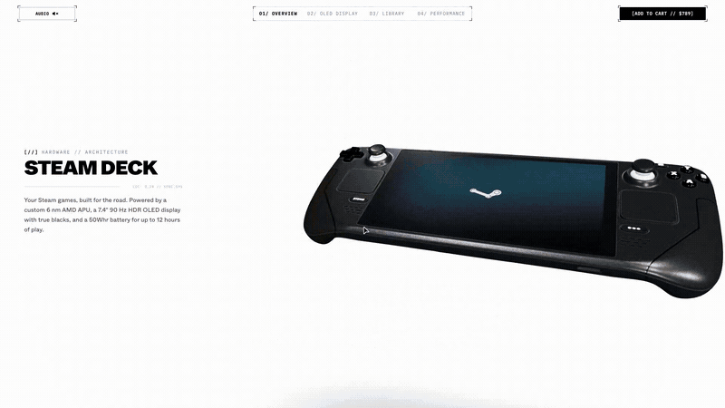

# Steam Deck 3D Showcase

An experimental, award-tier interactive 3D web experience celebrating the industrial design and hardware architecture of the Steam Deck. Built with Next.js, Three.js, React Three Fiber, and the Web Audio API, combining real-time PBR graphics, kinetic UI transitions, and zero-asset procedural audio into a seamless journey.

**Live Demo:** [https://3deck.dev](https://3deck.dev)

---

## Demo



---

## Technical Overview

### 1. 3D Model & PBR Shading — SteamDeck.tsx
The Steam Deck 3D model from steam_deck.glb renders via React Three Fiber. To map video streams and UI graphics accurately to the 16:10 display plane without distortion or vertical flipping, the screen mesh UV coordinates are normalized to `[0..1] x [0..1]` on component mount, eliminating the need to alter the source 3D asset.

Body materials use calibrated PBR shaders: the matte graphite polymer is configured with a roughness of `0.60` and metalness of `0.04`, keeping the console silhouette sharp against bright backgrounds. Two dynamic `THREE.PointLight` sources sit directly above the physical controls outside the screen perimeter to project realistic color bounce onto the thumbsticks, D-pad, and ABXY buttons matching the active video content, without washing out the screen glass or lifting black levels. Mouse and touch inputs are smoothed with `THREE.MathUtils.damp`, providing fluid depth parallax across both 60 Hz and 120 Hz displays.

### 2. Screen Controller & Dynamic Ambilight — SteamScreenTexture.ts
The boot animation plays through a frame sequencer of 121 WebP images. Each frame is fetched as binary data and decoded off the main thread with `createImageBitmap`, preventing UI hitches and video decoder stalls during fast forward and reverse scrolling.

Dynamic Ambilight backlighting samples pixel colors at ~10 Hz (every 100 ms) through an isolated 4x2 software canvas marked `willReadFrequently: true`, bypassing GPU pipeline flushes and decoder readback stalls. Light intensities and color tones are smoothly interpolated in the render loop with `THREE.MathUtils.damp`, maintaining a steady 60/120 FPS across desktop and mobile devices. Background video elements remain mounted in the DOM with fixed dimensions, preventing WebKit power management from evicting them from VRAM during inactive periods.

### 3. Library Ring & Spline Deformation — SteamLibraryRing.tsx
In the library view, 16 dual-sided OLED displays orbit a central sphere textured with a 120-game video atlas. Dragging the ring imparts angular momentum that decays through exponential friction down to an ambient idle drift of 0.085 rad/s.

The layout adapts dynamically to viewport dimensions. On every frame, the camera projection matrix calculates the ring's rightmost bounds in screen pixels using camera metrics tanHalfFov and pxPerUnit. If the margin to UI text cards drops below 36 pixels, the sphere and ring smoothly shift left to preserve comfortable reading space. When transitioning to the orbit view, the circular ring unwraps into a closed Catmull-Rom spline wave scene4LoopCurve, with each display's orientation aligned to the curve tangent.

### 4. Scene Transition Architecture — BladeShutter.tsx, PortalWipe.tsx
Each transition swaps scene state smoothly without frame drops:
- **Scene 1 ↔ Scene 2, Overview to OLED Darkroom:** The BladeShutter blades animate via CSS `transform` with a smooth Bezier curve. While the screen is covered, `deckState.ts` swaps the 3D scene behind it: switching from the white studio to the black Darkroom, routing screen colors into the Ambilight lights, and updating ambient audio with zero visual pop-in or frame drops.
- **Scene 1/2 → Scene 3, Entry into Library:** The portal expands using CSS `clip-path` shaped like a card with chamfered corners. To prevent shader compilation hitches when entering, the Scene 3 Three.js Canvas and textures stay pre-warmed in GPU memory. The camera smoothly glides from the console center to frame the library.
- **Scene 3 → Scene 4, Library Ring to Orbit Wave:** Displays unspool from a circular ring into an undulating 3D wave along a Catmull-Rom spline `THREE.CatmullRomCurve3`. Positions and tangents are evaluated via `getPointAt` and `getTangentAt` into reusable vectors without allocating heap memory (Zero GC), while display tilt follows the spline tangent.
- **Scene 4 → Scene 5, Orbit to Hardware Specs:** The animation is driven by scroll progress via `scene5Progress` (`dropT` from 0 to 1). In the first phase (`dropT` up to 0.16), scale matrices compress each display's width from 1.0 to 0.04 and rotate it 90° edge-on, while opacity fades to zero via `smoothstep`. At `dropT >= 0.16`, the display meshes are hidden and 16 faceted crystals take over. They split into two alternating streams by index parity and follow parametric double-helix equations with power-law spin acceleration and sinusoidal radius pulsation. When `dropT` exceeds 0.72, the crystals scatter outward along radial angles, clearing the viewport for the hardware specs overlay.

### 5. Procedural Web Audio Engine — soundEngine.ts
All sound effects are synthesized dynamically with the Web Audio API without downloading external audio files. Cooling fan noise is generated from pink noise using the Voss-McCartney algorithm and shaped through two resonant `BiquadFilterNode` filters modulated by scroll velocity. Interface clicks and shutter cuts use brief exponential gain envelopes. World coordinates of 3D objects are projected into screen space to drive a `StereoPannerNode`, delivering accurate spatial stereo panning.

---

## Performance Engineering

- **Sub-millisecond Ambilight sampling:** To extract real-time chassis lighting without GPU readback stalls, the 1280×800 display canvas is blitted onto a tiny 4×2 offscreen canvas using `willReadFrequently: true`. Reading back just 8 pixels (32 bytes) takes under 0.02 ms at 25 Hz, keeping the 60/120 FPS render loop completely free of compositor bottlenecks.
- **Seamless video loop transitions:** Browsers typically hitch or flash black when restarting video playback. To eliminate seam stutter on the 3D planet and orbit ring, the engine alternates between two video elements (`videoA` and `videoB`). The idle element starts pre-rolling 0.50 seconds before the loop point, creating an invisible, hitch-free handoff.
- **Dynamic video decoder throttling:** Mobile and desktop GPUs have strict limits on concurrent hardware video decoders. When navigating through Scenes 1 and 2, the heavy 120-game mosaic streams in the background are automatically paused. This frees up hardware decoders and memory bandwidth exclusively for the active console view.
- **Adaptive mobile shadow culling:** High-DPI screens can quickly overwhelm mobile GPUs. The canvas clamps resolution to a maximum device pixel ratio of 2.0 (`dpr={[1, 2]}`), and on narrow viewports (width ≤ 1024px or aspect ratio ≤ 1.15) it disables the 512×512 contact shadow pass to reduce thermal load and maintain fluid frame rates.
- **Zero-latency timeline scrubbing:** The 121-frame boot sequence downloads through an 8-worker parallel fetch queue to saturate the HTTP/2 connection without choking the network thread. When scrubbing the timeline faster than images can decode, a memory lookup instantly displays the nearest ready frame to prevent white flashes and perceived input lag.
- **Static shared audio memory:** Instead of allocating memory for every synthetic click or fan noise, procedural audio generators share pre-computed static memory buffers (`sharedNoiseBuffer`) inside a single `AudioContext`. This avoids garbage collection pauses on the Web Audio thread and requires zero audio file downloads over the network.

---

## Tech Stack

- **Runtime & Bundler:** Next.js 16 App Router, Turbopack
- **UI & Components:** React 19, TypeScript 5
- **3D Graphics:** Three.js r182+, React Three Fiber, Drei
- **Audio:** Web Audio API, custom procedural synthesis without audio files

---

## Repository Architecture

```
steamdeck-3d-showcase/
├── public/                             # Static public assets
│   ├── models/                         # Optimized 3D model asset steam_deck.glb
│   ├── sequence/                       # Screen boot frame sequence of 121 WebP frames
│   └── videos/                         # Gameplay video loops in H.264 format
└── src/
    ├── app/                            # Next.js App Router entry points
    │   ├── globals.css                 # Design system tokens and typography
    │   ├── layout.tsx                  # Root layout, meta tags, and font loading
    │   └── page.tsx                    # Main landing page entry
    ├── audio/                          # Procedural sound engine
    │   ├── soundEngine.ts              # Web Audio API synthesizer: fan, relays, stereo pan
    │   └── useSound.ts                 # React audio hook bridge
    ├── components/
    │   ├── 3d/                         # WebGL core React Three Fiber
    │   │   ├── Scene.tsx               # R3F Canvas, camera rig, and studio lighting
    │   │   ├── SteamDeck.tsx           # Console 3D mesh, PBR shading, bounce lights, parallax
    │   │   ├── SteamLibraryRing.tsx    # 16-blade library ring, core sphere, wave ribbon, crystals
    │   │   ├── SteamScreenTexture.ts   # Offscreen WebP frame decoder & canvas Ambilight sampler
    │   │   ├── deckState.ts            # Central reactive state orchestrator for all scenes
    │   │   └── gamesData.ts            # Game library metadata and texture atlas coordinates
    │   └── ui/                         # Modular HUD overlay and kinematic transitions
    │       ├── Overlay.tsx             # Root HUD coordinator and scene layout switch
    │       ├── HeaderBar.tsx           # Telemetry header, scene title & live time
    │       ├── DockLayer.tsx           # Floating bottom scene navigation dock
    │       ├── BladeShutter.tsx        # Mechanical shutter blades with glyph decryption
    │       ├── PortalWipe.tsx          # Fullscreen circular aperture iris shader
    │       ├── PerformanceSpecsOverlay.tsx # Hardware specs overlay: 6nm AMD APU, battery, fan
    │       ├── GameShowcaseReel.tsx    # Gameplay video carousel for OLED darkroom view
    │       ├── LoadingScreen.tsx       # Asset preloader and progress tracker
    │       ├── SoundToggle.tsx         # Audio mute / unmute toggle
    │       ├── navigationUtils.ts      # Decoupled DOM tab hit-testing and geometry metrics
    │       ├── overlayGeometry.ts      # Vector transforms and clip-path computations
    │       ├── useOverlayHeaderHover.ts# Header tab hover and sound interaction hook
    │       ├── useOverlayInteractions.ts# Tab switching, keyboard events and gestures
    │       └── useOverlayRafLoop.ts    # 60fps RAF loop animating HUD indicators
    ├── lib/                            # Mathematical utilities and geometry helpers
    └── types/
        └── global.d.ts                 # Global type definitions for window debug bridges
```

---

## Development

```bash
# Install dependencies
npm install

# Start local dev server
npm run dev

# Build for production
npm run build
npm run start
```

---

## License & Attribution

- **Code:** Licensed under the [MIT License](LICENSE) © 2026 [Maksim Yaletski](https://github.com/scr01ex). Free to explore and learn from.
- **Trademark Notice:** Steam, Steam Deck, SteamOS, and the Steam logo are registered trademarks of Valve Corporation. This project is an independent creative demonstration and is not affiliated with or endorsed by Valve.

---

## Author

**Maksim Yaletski**

[](https://t.me/scr01ex)
[](https://github.com/scr01ex)
